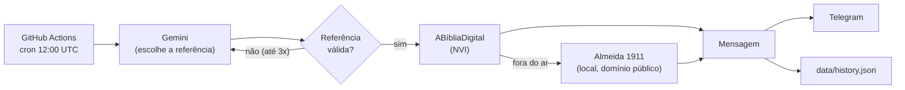

# Palavra do Dia

Todo dia às 9h (horário de Brasília) chega no meu Telegram uma passagem da Bíblia. Fiz esse projeto para ter esse momento no dia sem precisar lembrar de abrir nada, e também para praticar como integrar uma IA num fluxo em que ela não pode errar.

A regra central é simples: a IA só escolhe a referência (por exemplo, "Salmos 23:1-4"). O texto do versículo vem sempre de uma API bíblica. O modelo nunca escreve versículo nenhum, então não existe risco de ele inventar ou "lembrar errado" uma passagem.

## Como funciona



1. O código sorteia um grupo de livros (Pentateuco, Profetas, Evangelhos...) para manter o equilíbrio entre Antigo e Novo Testamento. A IA escolhe dentro do grupo.
2. O Gemini responde em JSON estruturado: `book`, `chapter`, `verse_start` e `verse_end` (de 1 a 5 versículos que façam sentido juntos).
3. O código valida a referência: o livro existe, o capítulo existe, os versículos existem e a passagem não está no histórico recente. Se algo falhar, a IA tenta de novo e recebe o motivo da recusa.
4. O texto é buscado na API (o capítulo inteiro, que depois é fatiado localmente). Se a API estiver fora, entra o fallback local.
5. A mensagem vai para o Telegram e só depois é gravada no histórico. Assim, uma falha no envio não "gasta" o dia.

## Decisões de projeto

| Decisão | Por quê |
|---|---|
| A IA só escolhe a referência | O texto bíblico nunca passa pelo modelo |
| Saída estruturada + validação com pydantic | A IA pode sugerir um "João 3:99". O código não confia na resposta sem checar |
| `BibleProvider` como interface | Dá para trocar de API ou adicionar fontes sem mexer no resto |
| Fallback local | A ABíbliaDigital original foi encerrada em 01/08/2026 e o projeto atual é mantido pela comunidade |
| 404 só vira "referência inválida" se vier o JSON da API | Um 404 de infraestrutura deve acionar o fallback, não gastar as tentativas da IA |
| Token do Telegram fora dos logs | O token fica na URL e as exceções do `httpx` o mostram, então elas são relançadas sem ele |
| Histórico versionado no repositório | Dispensa banco de dados, dá para auditar e evita repetição |
| Execução idempotente por dia | Rodar o workflow de novo no mesmo dia não duplica o envio |

## Estrutura

```
src/palavra_do_dia/
  books.py        # catálogo dos 66 livros e grupos
  models.py       # PassageReference (validada), Passage, HistoryEntry
  selector.py     # Gemini: prompt + saída estruturada
  bible/          # providers (remoto, local) + serviço de fallback
  history.py      # histórico em JSON, escrita atômica
  notifier.py     # formatação + Telegram
  pipeline.py     # fluxo principal (retry, idempotência, dry-run)
  main.py         # CLI
data/             # history.json e texto local de fallback
tests/            # pytest (rede e IA são sempre simuladas)
```

## Como rodar

Você precisa de Python 3.12+ e do [uv](https://docs.astral.sh/uv/).

```bash
uv sync
cp .env.example .env   # preencha os valores
uv run --env-file .env palavra-do-dia --dry-run   # escolhe e imprime, sem enviar
uv run --env-file .env palavra-do-dia             # envia de verdade
```

| Variável | Obrigatória | Descrição |
|---|---|---|
| `GEMINI_API_KEY` | sim | Chave do Google AI Studio |
| `GEMINI_MODEL` | sim | Nome exato do modelo (não tem valor padrão de propósito) |
| `TELEGRAM_BOT_TOKEN` | sim* | Token do @BotFather |
| `TELEGRAM_CHAT_ID` | sim* | Id do seu chat |

\* Não é exigida com `--dry-run`.

Opcionais: `BIBLE_VERSION` (padrão `nvi`), `HISTORY_WINDOW` (padrão `60`) e `MAX_SELECTION_ATTEMPTS` (padrão `3`).

## Deploy gratuito com GitHub Actions

Cadastre as 4 variáveis acima em **Settings → Secrets and variables → Actions**. O workflow [daily.yml](.github/workflows/daily.yml) roda às 12:00 UTC (9h em Brasília), pode ser disparado manualmente e commita o histórico.

- Se o script falhar, o job falha (o GitHub avisa por e-mail) e uma mensagem de alerta vai para o Telegram.
- O cron do GitHub pode atrasar alguns minutos. É normal.

## Testes e qualidade

```bash
uv run ruff check . && uv run ruff format --check .
uv run mypy
uv run pytest --cov=palavra_do_dia
```

O CI ([ci.yml](.github/workflows/ci.yml)) roda tudo isso a cada push.

## Fontes e licenças dos textos

- **NVI** (texto principal): buscada em tempo de execução na API [ABíbliaDigital](https://abibliadigital.api.br). A NVI tem direitos autorais da Biblica, por isso este repositório não guarda o texto dela.
- **Almeida 1911** (`data/almeida1911.json`, fallback): vem de [damarals/biblias](https://github.com/damarals/biblias). A licença MIT desse repositório cobre o código dele, não necessariamente o texto. Confira o status de domínio público antes de redistribuir.

## Próximos passos

- [ ] Widget Android
