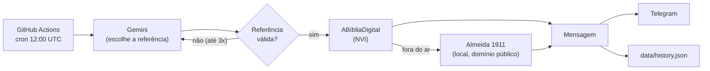

# 📖 Palavra do Dia

Automação que entrega uma passagem bíblica todo dia às 9h (horário de Brasília) via Telegram.

**A IA escolhe só a *referência*. O texto vem sempre de uma API bíblica.** Isso elimina o risco de alucinação no texto exibido: o modelo nunca escreve versículos.

## Como funciona



1. O código sorteia um **grupo de livros** (Pentateuco, Profetas, Evangelhos…) para garantir variedade entre AT e NT. A IA escolhe dentro do grupo.
2. O Gemini devolve JSON estruturado: `book`, `chapter`, `verse_start`, `verse_end` (1 a 5 versículos que façam sentido completo).
3. O código **valida** a referência: livro existe, capítulo existe, versículos existem, não repete o histórico recente. Se falhar, a IA tenta de novo recebendo o motivo da rejeição.
4. O texto é buscado na API (capítulo inteiro, fatiado localmente). Se a API estiver fora, cai no fallback local.
5. Envia ao Telegram e só então registra no histórico (falha de envio não "queima" o dia).

## Decisões de engenharia

| Decisão | Motivo |
|---|---|
| IA só escolhe a referência | Zero alucinação no texto bíblico |
| Saída estruturada + validação com pydantic | A IA pode inventar `João 3:99`; o código nunca confia nela |
| `BibleProvider` como interface | Trocar de API ou adicionar fontes sem mexer no resto |
| Fallback local | A ABíbliaDigital original foi encerrada em 01/08/2026; o projeto atual é comunitário |
| 404 só vira "referência inválida" se vier o JSON da API | Um 404 de infraestrutura deve acionar o fallback, não gastar tentativas da IA |
| Token do Telegram nunca vai para logs/erros | O token fica na URL; exceções do `httpx` o expõem, então são re-lançadas sem ele |
| Histórico versionado no repositório | Sem banco de dados; auditável; evita repetição |
| Idempotência diária | Reexecutar o workflow no mesmo dia não duplica o envio |

## Estrutura

```
src/palavra_do_dia/
  books.py        # catálogo dos 66 livros e grupos
  models.py       # PassageReference (validada), Passage, HistoryEntry
  selector.py     # Gemini: prompt + saída estruturada
  bible/          # providers (remoto, local) + serviço de fallback
  history.py      # histórico em JSON, escrita atômica
  notifier.py     # formatação + Telegram
  pipeline.py     # caso de uso (retry, idempotência, dry-run)
  main.py         # CLI
data/             # history.json e texto local de fallback
tests/            # pytest (rede e IA são sempre simuladas)
```

## Configuração

Requisitos: Python 3.12+ e [uv](https://docs.astral.sh/uv/).

```bash
uv sync
cp .env.example .env   # preencha os valores
uv run --env-file .env palavra-do-dia --dry-run   # escolhe e imprime, sem enviar
uv run --env-file .env palavra-do-dia             # envia de verdade
```

| Variável | Obrigatória | Descrição |
|---|---|---|
| `GEMINI_API_KEY` | sim | Chave do Google AI Studio |
| `GEMINI_MODEL` | sim | Nome exato do modelo (sem padrão, de propósito) |
| `TELEGRAM_BOT_TOKEN` | sim* | Token do @BotFather |
| `TELEGRAM_CHAT_ID` | sim* | Seu chat id |

\* Não exigido com `--dry-run`.

Opcionais: `BIBLE_VERSION` (`nvi`), `HISTORY_WINDOW` (`60`), `MAX_SELECTION_ATTEMPTS` (`3`).

## Deploy gratuito (GitHub Actions)

Cadastre os 4 itens acima em **Settings → Secrets and variables → Actions**. O workflow [daily.yml](.github/workflows/daily.yml) roda às 12:00 UTC (9h BRT), pode ser disparado manualmente e commita o histórico.

- Se o script falhar, o job falha (o GitHub avisa por e-mail) e uma mensagem de alerta é enviada ao Telegram.
- O cron do GitHub pode atrasar alguns minutos. É normal.

## Qualidade

```bash
uv run ruff check . && uv run ruff format --check .
uv run mypy
uv run pytest --cov=palavra_do_dia
```

O CI ([ci.yml](.github/workflows/ci.yml)) roda tudo isso a cada push.

## Fontes e licenças dos textos

- **NVI** (texto principal): obtida em tempo de execução da API [ABíbliaDigital](https://abibliadigital.api.br). A NVI é protegida por direitos autorais da Biblica; este repositório **não** armazena o texto da NVI.
- **Almeida 1911** (`data/almeida1911.json`, fallback): origem [damarals/biblias](https://github.com/damarals/biblias). A licença MIT desse repositório cobre o código dele. Verifique o status de domínio público do texto antes de redistribuir.
- O código deste projeto é de autoria do dono do repositório.

## Roadmap

- [ ] Widget Android (fase 2)
